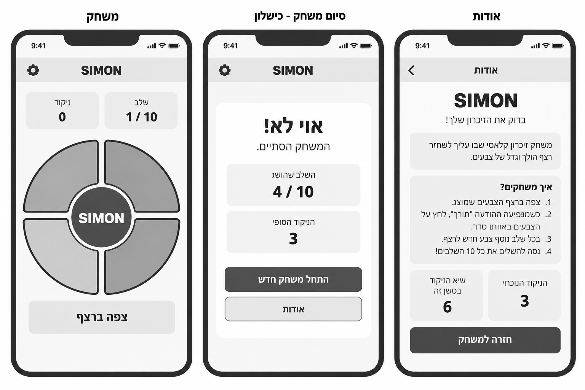
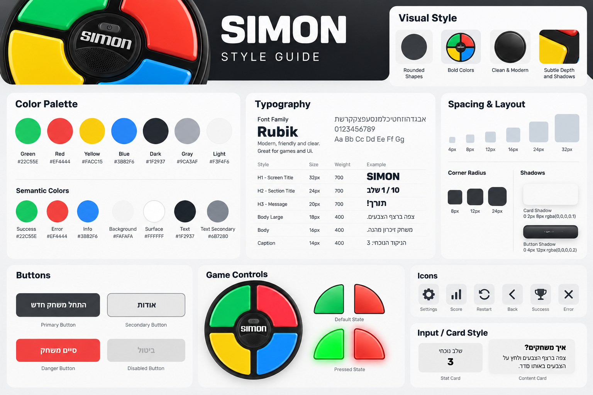

# DESIGN – Simon

מסמך זה מגדיר את עיצוב ממשק המשחק בהתאם ל־PRD, ל־Wireframes, ל־Style Guide ול־Mockups. ה־PRD הוא המקור המחייב להתנהגות המוצר; התמונות מגדירות את הפריסה ואת המראה החזותי.

## 1. Screens – מסכי האפליקציה

**הבהרת עקביות:** ב־Wireframes וב־Mockups מוצגות שלוש תצוגות חזותיות: ״משחק״, ״סיום משחק - כישלון״ ו״אודות״. לפי ה־PRD קיימים **שני מסכים בלבד**. ״סיום משחק - כישלון״ הוא מצב של מסך המשחק, ולא מסך שלישי או נתיב ניווט נפרד. בהתאם לכך, המימוש יכלול שני מסכים ושינוי מצב בתוך מסך המשחק.

### 1.1 מסך משחק (בית)

**מטרה:** להציג את לוח Simon, את התקדמות השחקן ואת הפעולה המתאימה למצב המשחק.

**מבנה ותוכן:**
- פס עליון כהה: הכיתוב `SIMON` במרכז ואייקון ניווט ל״אודות״ בקצה השמאלי, כפי שמופיע בתמונות.
- שתי תיבות נתונים זו לצד זו, בסידור RTL: ״שלב״ מימין (למשל `1 / 10`) ו״ניקוד״ משמאל (למשל `0`).
- לוח Simon גדול וממורכז: ארבעה רבעי עיגול סביב דיסקה מרכזית כהה עם הכיתוב `SIMON`. מיקומי הצבעים: ירוק למעלה־שמאל, אדום למעלה־ימין, צהוב למטה־שמאל, כחול למטה־ימין.
- מתחת ללוח: אזור הודעת מצב בולט, למשל ״צפה ברצף״ או ״תורך!״.
- במצב ההתחלתי מוצג כפתור ״התחל״, בהתאם ל־PRD; תצוגת ה־Wireframe מתארת מצב משחק פעיל ולכן אינה מציגה אותו.

**פעולות וניווט:**
- לחיצה על ״התחל״ מפעילה את המשחק.
- ארבעת רבעי העיגול משמשים ללחיצה בתור השחקן; בעת הצגת הרצף הם אינם פעילים.
- אייקון הניווט פותח את ״אודות״ ומשהה את המשחק הפעיל.
- ההודעות משתנות לפי מצב המשחק בלי מעבר למסך נוסף.

### 1.2 מצב סיום משחק – בתוך מסך המשחק

**מטרה:** להציג תוצאת משחק ולאפשר התחלה מחדש.

**מבנה ותוכן:**
- אותו פס עליון ואותה מסגרת עיצובית של מסך המשחק.
- במצב כישלון, כפי שמודגם ב־Mockup: כרטיס כהה עם הדגשת שגיאה אדומה, סמל X, הכותרת ״אוי לא!״ והטקסט ״המשחק הסתיים.״.
- שתי תיבות נתונים אנכיות: ״השלב שהושג״ ו״הניקוד הסופי״.
- כפתור פעולה ראשי ״משחק חדש״ וכפתור משני ״אודות״.
- מצב ניצחון משתמש באותו אזור תוצאה עם הודעת הניצחון מה־PRD: ״כל הכבוד! ניצחת!״; אין ליצור עבורו מסך נפרד.

**פעולות וניווט:** ״משחק חדש״ מתחיל משחק חדש; ״אודות״ פותח את מסך האודות. תצוגת הסיום מחליפה את תוכן המשחק הפעיל, ללא יצירת מסלול ניווט נוסף.

### 1.3 מסך אודות

**מטרה:** להציג מידע על המשחק, הוראות, ניקוד נוכחי ושיא הסשן.

**מבנה ותוכן:**
- פס עליון כהה עם כותרת ״אודות״ וכפתור חזרה בקצה השמאלי, בהתאם לתמונות.
- כותרת מרכזית `SIMON` ומתחתיה משפט תיאור קצר: ״בדוק את הזיכרון שלך!״.
- כרטיס תיאור קצר על המשחק.
- כרטיס ״איך משחקים?״ ובו הוראות ממוספרות בעברית, מיושרות לימין.
- שתי תיבות ניקוד זו לצד זו, בסידור RTL: ״הניקוד הנוכחי״ מימין ו״שיא הניקוד בסשן זה״ משמאל.
- כפתור ראשי רחב בתחתית: ״חזרה למשחק״.

**פעולות וניווט:** לחיצה על החץ או על ״חזרה למשחק״ מחזירה למסך המשחק, למצב שבו היה לפני המעבר.

### 1.4 מבנה הניווט

הניווט כולל **משחק ↔ אודות** בלבד. מצב סיום משחק מוצג בתוך מסך המשחק. אין מסכי ביניים, תפריטי משנה או מסך תוצאות עצמאי.

### Wireframes

### Mockups

## 2. Style Guide – השפה העיצובית

### 2.1 Color Palette

הצבעים מבוססים על קודי HEX המוצגים ב־Style Guide. במשחק עצמו משולבת פלטה זוהרת על רקע כהה, כפי שמוצג ב־Mockups.

| Token | HEX | שימוש |
|---|---|---|
| Green | `#22C55E` | רבע העיגול הירוק; Success |
| Red | `#EF4444` | רבע העיגול האדום; Error |
| Yellow | `#FACC15` | רבע העיגול הצהוב |
| Blue | `#3B82F6` | רבע העיגול הכחול; פעולת חזרה במשחק |
| Dark | `#1F2937` | משטחים כהים וטקסט כהה ב־Style Guide |
| Gray | `#9CA3AF` | גוון משני |
| Light | `#F3F4F6` | גוון בהיר |
| Background | `#FAFAFA` | רקע בהיר המוצג ב־Style Guide |
| Surface | `#FFFFFF` | משטחים בהירים |
| Text Secondary | `#6B7280` | טקסט משני בגרסה הבהירה |

**התאמה ל־Mockups:** שלושת ה־Mockups משתמשים בפועל ברקע כמעט שחור/כחול־שחור, בכרטיסים כחולים־כהים, בטקסט לבן ובאפקטי הארה. גווני הרקע הכהים המדויקים אינם מסומנים בקוד HEX ב־Style Guide, ולכן יש להתאים אותם חזותית ל־Mockups ולא להציג קוד משוער כערך מקורי. צבעי ארבעת רבעי המשחק נשארים נאמנים לערכי ה־HEX המפורשים.

### 2.2 Typography

- **Font Family:** `Rubik`, עם fallback לגופן sans-serif תומך עברית.
- **H1 – Screen Title:** `32px`, משקל `700`.
- **H2 – Section Title:** `24px`, משקל `700`.
- **H3 – Message:** `20px`, משקל `700`.
- **Body Large:** `18px`, משקל `400`.
- **Body:** `16px`, משקל `400`.
- **Caption:** `14px`, משקל `400`.
- כותרות וערכי ניקוד בולטים במשקל ובגודל; הסברים משניים רגועים יותר.
- הכיתוב `SIMON` מופיע באנגלית כשם המשחק, בעוד התוויות וההוראות בעברית.

### 2.3 UI Style

**כפתורים:** כפתורים רחבים, פינות מעוגלות, טיפוגרפיה מודגשת ומרכוז טקסט. כפתור ראשי כהה או כחול בהתאם להקשר, כפתור משני כהה/מתוחם, ובמצב כישלון כפתור ״משחק חדש״ אדום בהתאם ל־Mockup. ה־Style Guide מציג גם מצב Disabled באפור.

**לוח המשחק:** ארבעה מקטעים מעוגלים עם מסגרת כהה עבה, הפרדות שחורות ברורות ודיסקה מרכזית כהה. המקטעים מקבלים עומק באמצעות Highlights, הצללה והארה בזמן הפעלה. זהו רכיב ה־UI המרכזי והבולט ביותר במסך.

**כרטיסים:** רקע כהה עם הבדל טונאלי מהרקע הראשי, קו מתאר עדין, פינות מעוגלות וצל רך. תיבות ניקוד קומפקטיות; כרטיסי הוראות ותוצאה גדולים יותר.

**אייקונים:** אייקונים פשוטים ועבים יחסית, כגון ניווט לאודות, חזרה, ניקוד, הישג ושגיאה. יש לשמור על אותו משקל קו וסגנון לאורך המסכים. אייקון גלגל השיניים בתמונות משמש לניווט ל״אודות״ בלבד; אין להוסיף מסך הגדרות.

**שדות קלט:** דוגמת `Input / Card Style` ב־Style Guide משמשת השראה לטיפול בכרטיסים בלבד. לפי ה־PRD אין טפסים או שדות קלט, ולכן אין להוסיף אותם לממשק.

### 2.4 Visual Style

- **צורות:** לוח עגול ומקטעי רבע־עיגול, כרטיסים מלבניים מעוגלים.
- **Corner Radius:** ערכי דוגמה ב־Style Guide: `8px`, `12px`, `24px`; שימוש בפינות גדולות יותר בכרטיסים בולטים.
- **Spacing:** סולם מרווחים `4px`, `8px`, `12px`, `16px`, `24px`, `32px`.
- **Shadows:** דוגמת Card Shadow – `0 2px 8px rgba(0,0,0,0.1)`; דוגמת Button Shadow – `0 4px 12px rgba(0,0,0,0.2)`. ב־Mockups קיימת גם הארה סביב צבעי הלוח וסביב מצב שגיאה.
- **Layout:** עמודת תוכן מרכזית ברוחב מסך נייד, כותרת עליונה, אזורי מידע, רכיב משחק מרכזי ואזור פעולות בתחתית. זוגות כרטיסי ניקוד מסודרים זה לצד זה.
- **אווירה:** משחקית, אנרגטית וברורה; שילוב של חומריות כהה ומבריקה עם צבעים רוויים וזוהרים. אין שימוש בצילומים בתוך מסכי המוצר.
- **אייקונוגרפיה והמחשות:** אין צורך באיורים נפרדים; לוח Simon עצמו הוא האלמנט החזותי הדומיננטי.

### 2.5 שפה וכיווניות

- שפת הממשק: **עברית בלבד**, כיווניות `RTL`.
- טקסטי הוראות ותוויות מיושרים לימין; כותרות ראשיות, נתוני ניקוד והודעות מצב יכולים להיות ממורכזים בהתאם ל־Mockups.
- שם המשחק `SIMON` נשאר באנגלית ובכיוון `LTR` כיחידת טקסט עצמאית.
- סדר כרטיסי הניקוד, הסעיפים הממוספרים ורכיבי התוכן נשמר בהתאם לממשק RTL.
- הממשק מיועד ל־Mobile-first; מסגרות הטלפון שבתמונות הן להמחשה בלבד ואינן חלק מרכיבי האפליקציה.

### Style Guide

---

**סדר עדיפות במקרה של אי־התאמה:** ה־PRD קובע אילו מסכים, פעולות ומצבים קיימים; ה־Wireframes קובעים את מבנה התצוגות; ה־Style Guide קובע את שפת העיצוב והערכים המפורשים; ה־Mockups קובעים את הביטוי החזותי הסופי. אין לפרש אייקון או תצוגת מצב כהיתר להוסיף יכולת חדשה.
